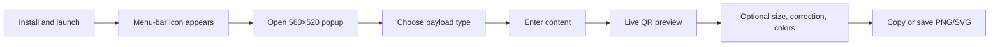

# DewQRaft Product Report

Assessment date: 20 July 2026

Product version examined: 1.1 (build 2)
Repository state examined: `main` at `f4a7a5d`

## Evidence and status language

This is an evidence-based product assessment of the repository and its current release artifacts. It is not external market research. Comparisons are against broad alternative categories visible from the product problem, not a live survey of named competitors.

- **Implemented** — supported by current code or artifacts.
- **Partial** — present, but incomplete or not validated end to end.
- **Planned** — documented but absent from current code.
- **Inferred** — reasoned from the available evidence.
- **Unknown** — not established by the repository.

## 1. Executive summary

DewQRaft is an offline macOS menu-bar utility for quickly creating QR codes and copying or saving them as PNG or SVG. It handles six common payload types—text/link, Wi-Fi, contact, email, phone, and SMS—without an account, network service, or permanent Dock window.

Its clearest product promise is:

> Open a small menu-bar popup, enter the content, and leave with a usable QR code—without uploading the content anywhere.

That promise is relevant because QR generation is often a tiny task embedded in a larger workflow: placing a link into a deck, transferring Wi-Fi credentials, producing a contact card, preparing event signage, or moving information from a Mac to a phone. A full design suite is excessive; a web generator introduces browsing, ads, account prompts, or privacy questions; a script is too technical for many users.

### Product verdict

**Implemented as a coherent utility; not yet supported as a production-ready public release.**

The product concept is focused, the architecture is low-cost and privacy-friendly, and the checked-in ZIP/DMG are structurally valid. However, the repository's own release checklist says **DO-NOT-SHIP**. Physical scan tests, installed menu-bar behavior, real clipboard/save behavior, cancellation, appearance persistence, quit, and Wi-Fi-off operation have no recorded manual passes. The known save-panel interaction with the transient popup also remains unresolved in current code.

The immediate bottleneck is therefore release trust, not feature breadth.

### Snapshot

| Dimension | Assessment |
|---|---|
| Problem clarity | **Strong.** One small recurring task with a short expected path. |
| Core implementation | **Implemented.** Six payload types, live QR, PNG/SVG copy/save, sizes, correction, colors, four looks. |
| Privacy model | **Strong by architecture.** No backend, telemetry, accounts, or external resources. |
| User-flow validation | **Weak / unknown.** The 24-row manual release matrix is effectively unrun. |
| Distribution readiness | **Partial.** Universal ZIP/DMG exist and validate, but the app is ad-hoc signed and not notarized. |
| Operational burden | **Low.** No hosted service or database. |
| Strategic priority | Resolve native workflow and release acceptance before adding new capability. |

## 2. The problem and current alternatives

### The user problem

Creating a QR code is mechanically simple but operationally awkward. Users commonly have to:

1. Open a browser or large design tool.
2. Find a trustworthy generator.
3. Decide whether sensitive content is being uploaded.
4. Enter content in the right format.
5. Export a usable image.
6. Return to the original task.

DewQRaft compresses this into a menu-bar interaction and supplies structured fields for formats users would otherwise need to remember.

### Alternative categories

| Alternative | Why users choose it | Where DewQRaft can be better | Where DewQRaft is weaker today |
|---|---|---|---|
| Web QR generators | Immediate access, no install, often many design options | Local processing, no browsing context switch, no upload ambiguity, native copy/save | Installation friction; ad-hoc signing; fewer advanced styles or campaigns |
| Design applications | QR can be placed directly into visual work | Faster for one-off creation; far lighter | No composition canvas, brand system, templates, or print workflow |
| Shortcuts/scripts/CLI tools | Flexible and automatable | Accessible to nontechnical users; live visual result | No automation or batch interface |
| General desktop QR utilities | Native availability and similar offline promise | Focused six-mode flow and transparent implementation | No evidence here of broader differentiation, polish, support, or distribution advantage |
| Manually sharing/copying content | Requires no QR app | QR is better for cross-device transfer and physical surfaces | A QR code is unnecessary when direct sharing is already convenient |

No external competitor benchmark was performed for this report. Any decision about price, category leadership, or missing table-stakes features needs current market research.

## 3. Users and jobs to be done

### Primary user groups

#### 1. Privacy-conscious individual Mac users

They need to transfer a URL, Wi-Fi credential, phone number, or message to another device without placing it into a web service.

**Fit:** high. Offline, account-free operation directly supports this job.

#### 2. Developers, designers, and product teams

They need a clean QR asset for a prototype, deck, README, release note, test fixture, or event screen.

**Fit:** high for one-off PNG/SVG generation. SVG copy is particularly useful for downstream editing.

#### 3. Small-business and event operators

They need menu, payment-link, feedback, Wi-Fi, contact, or registration codes quickly.

**Fit:** moderate. The current app is fast, but physical scanning, print reliability, branded export, and distribution trust need stronger evidence.

#### 4. Support and operations staff

They need to put structured contact, email, phone, SMS, or Wi-Fi actions in front of customers.

**Fit:** moderate. Structured forms reduce syntax errors, but there is no history, templates, batch mode, or shared configuration.

### Users the current product does not serve well

- Teams needing shared libraries, permissions, audit history, or administration.
- Marketers needing dynamic QR redirects, analytics, campaign management, or editable destinations.
- Print professionals needing EPS/PDF, color-profile control, branded frames, logos, or preflight tools.
- Windows, Linux, iPhone, iPad, and Android users.
- Automation-heavy users needing a CLI, Shortcuts/App Intents, batch processing, or an API.

Those exclusions are not necessarily defects. They define the current product's narrowness.

## 4. Product experience

### Intended core journey

### First launch

**Partial.** The app is configured as a menu-bar agent with no normal Dock icon. The first text field is empty and has the placeholder “Paste text or a link”; there is no DewFlash URL or other prefilled payload. This is correctly implemented in `DewQRaft/Resources/index.html:814-817`.

The release is ad-hoc signed, so README warns that a user may have to right-click and choose Open. That is acceptable for a personal/internal utility but poor first-run trust for a broad audience.

### Creation flow

**Implemented in code and smoke tests.** Six tabs expose the supported payload types. Input changes render immediately. Empty required fields produce no QR and disable output. Oversized input shows “Too long for one QR code” rather than a raw encoder message.

The immediate preview is the right interaction model for this tool: it keeps cause and effect visible and makes code color/background changes understandable. The payload preview offers transparency into the encoded text, which is especially useful for technical users and troubleshooting.

### Appearance flow

**Implemented.** The settings button switches the popup into an appearance-only state. It hides the original content controls and actions while keeping:

- Four look choices: Focused, Native, Command, Original.
- Interface accent and window color.
- QR code and background colors.
- A Reset Colours action.
- The QR preview.

All four looks reuse the same semantic controls and one stable settings composition rather than presenting four incompatible settings screens. Interface accent, window color, and selected look persist. QR foreground/background colors do not persist.

The four-look system increases user choice but also raises a product question: does the audience want personalization, or does it want one impeccably native, predictable tool? Current source proves the implementation; it does not prove which look improves completion or trust.

### Output flow

**Implemented at the code-contract level; partial end to end.** PNG and SVG can each be copied or saved. PNG output is a rendered image; SVG copy places XML text on the clipboard. Save invokes a native `NSSavePanel` and writes atomically.

The unresolved issue is native behavior from a transient menu-bar popup. Historical blocker evidence says a proposed close/reopen flow passed automated checks but could not be manually accepted and was reverted. The current code still calls `NSSavePanel.begin` directly while the host popover is transient. This must be treated as a known release risk, not a hypothetical polish item.

### Failure states

Current visible failure handling includes:

- Empty state with disabled actions.
- Friendly overflow status.
- “Nothing to save” if native data decoding has no payload.
- “Save failed” after a file-write error.
- “Copy not available” in browser fallback mode.

Gaps include structured details, retry guidance, save-cancel feedback, and recovery if the bundled HTML is missing. The native missing-HTML screen exists, but it is a bare internal fallback rather than a supported recovery path.

## 5. Capability inventory

| Capability | Status | Product meaning |
|---|---|---|
| Menu-bar-only macOS app | **Implemented** | Low-friction access without a persistent window or Dock presence. |
| Empty initial state | **Implemented** | No unwanted branded/default destination. |
| Text/link QR | **Implemented** | General-purpose payload path. |
| Wi-Fi QR | **Implemented** | Supports WPA/WPA2, WEP, open network, hidden flag, and escaping. |
| vCard 3.0 | **Implemented** | Name, phone, email, company, and website. |
| Email, phone, SMS | **Implemented** | Structured receiver actions with URL encoding/whitespace handling. |
| Live QR generation | **Implemented** | Local, immediate preview. |
| Error correction | **Implemented** | Low, Medium, High, Very high. |
| Export sizes | **Implemented** | 512, 1024, and 2048 pixels. |
| PNG copy/save | **Partial** | Rendering and bridge are tested; real native clipboard/save acceptance is not recorded. |
| SVG copy/save | **Partial** | SVG structure and bridge are tested; real native output flow is not recorded. |
| Full QR background color | **Implemented in rendering** | Preview frame, PNG, and SVG all receive the selected solid background. |
| QR foreground color | **Implemented** | User-controlled module color. |
| Four UI looks | **Implemented** | Focused, Native, Command, Original. |
| Persisted interface theme | **Implemented in code** | Accent, window color, and look use WebKit localStorage. Relaunch persistence is not manually accepted. |
| Reset Colours | **Implemented** | Restores Apple blue/neutral interface and black-on-white QR defaults while preserving look. |
| Dark mode and reduced motion | **Implemented in CSS** | Basic platform preference support. |
| Fully offline use | **Implemented by architecture; manual acceptance pending** | Bundled resources, no network service or account. |
| Launch at Login | **Planned / not implemented** | Historical attempt was reverted; right-click menu contains only Quit. |
| Dynamic QR codes/analytics | **Not implemented** | No redirect service or tracking. |
| History/templates/batch | **Not implemented** | Every payload is an immediate one-off. |
| Developer ID/notarization | **Not implemented** | Current app is ad-hoc signed. |

## 6. Product architecture and why it matters

### Local-first design

The app bundles its interface and encoder. QR matrices are computed in memory, and exports go only to the user's clipboard or chosen file. The only persistent product setting is a local theme object.

Product benefits:

- No account setup.
- No network latency or server outage.
- No infrastructure bill.
- No need to retain user payloads.
- A credible privacy story for Wi-Fi credentials and contact data.

Product responsibilities created by this choice:

- Offline behavior still needs installed-app acceptance.
- Privacy claims should remain precise: local processing, no telemetry in this build, and no content persistence by the app.
- The app must maintain its bundled encoder and macOS compatibility itself.

### Hybrid native/web implementation

AppKit supplies the system surfaces that matter—menu bar, popup, clipboard, save panel—while a local web UI supplies flexible layout and rapid input/rendering behavior.

For users, the technology is irrelevant if the result feels native. For maintainers, the hybrid model is efficient at this scale. The main product risk is seam quality: focus, popup dismissal, keyboard commands, save panels, accessibility, and appearance need real macOS testing because an offscreen web test cannot prove them.

### No hosted operations

There is no server, user database, authentication, billing, analytics, or remote configuration. This makes recurring operating cost close to zero **inferred from architecture**, excluding developer time, signing-program fees, support, and distribution costs.

## 7. Differentiation and defensibility

### Current differentiators

1. **Offline and account-free.** Strongest clear value proposition.
2. **Menu-bar immediacy.** The app stays out of the Dock and avoids a full window.
3. **Structured payload forms.** Users do not need to know Wi-Fi, vCard, mailto, tel, or SMS syntax.
4. **Both raster and vector output.** PNG serves ordinary use; SVG serves design/development workflows.
5. **Transparent payload preview.** Users can inspect what is encoded.
6. **Small operational footprint.** No dependency graph or hosted service.

### What is not defensible by itself

QR generation, color selection, and common payload formats are commodity capabilities. Four interface looks are a preference feature, not a durable moat. The code is compact enough that a competent competitor could reproduce the basic feature set.

### More credible long-term advantage

If DewQRaft develops an advantage, it will come from trust and workflow quality:

- Reliably scannable output across devices and contexts.
- Excellent native menu-bar behavior.
- Fast keyboard operation.
- Clear privacy and no telemetry.
- Trusted signing/notarization and painless updates.
- Thoughtful interoperability fixtures for Wi-Fi, contacts, email, phone, and SMS.

That is a quality moat, not a feature-count moat.

## 8. Maturity, quality, and trust

### Maturity assessment

The following scores are an **inferred editorial assessment**, not measured KPIs:

| Area | Score | Reason |
|---|---:|---|
| Product focus | 4/5 | Clear job, little scope creep, coherent offline promise. |
| Core feature completeness | 4/5 | All stated creation modes and exports exist. |
| Automated behavior coverage | 3/5 | Strong offscreen UI/bridge smoke coverage, no native integration suite. |
| Native UX confidence | 1/5 | Manual release checklist is unrun; save flow is a known risk. |
| Accessibility confidence | 1.5/5 | Semantic web controls and reduced motion exist, but no VoiceOver/keyboard audit. |
| Distribution readiness | 1.5/5 | Valid universal archives, but ad-hoc signing and no notarization. |
| Operational simplicity | 5/5 | No backend, accounts, or service dependencies. |
| Overall release maturity | 2/5 | Good working foundation; insufficient release evidence for public trust. |

### Privacy

**Strong by implementation.** No network API, telemetry, analytics, account, or cloud persistence is present. Payloads are not saved to localStorage. Users explicitly choose clipboard or filesystem output.

**Unknown outside the repository.** There is no reviewed privacy statement, external binary audit, or network-monitoring acceptance record. Public claims should describe observable behavior rather than use absolute legal language.

### Security and supply chain

The attack surface is small: one native binary, bundled local HTML, and two vendor scripts. There is no runtime download or updater. The QR vendor sources contain MIT license headers.

Risks:

- Ad-hoc signing proves bundle integrity after local construction but does not provide Developer ID identity or notarization trust.
- `WKWebView` is a capable engine; the app should continue loading only bundled content and should avoid adding arbitrary navigation.
- The JavaScript bridge accepts dictionaries and ignores unknown message types, but it has no formal schema or size limits.
- There is no root third-party notice or documented dependency-upgrade policy.

### Reliability

The build and packaging design is disciplined: temporary caches, universal Release output, deterministic icon validation, strict signature checks, and ZIP/DMG integrity checks. The current 1.1 archives passed independent structural validation during this assessment.

However, the current workspace itself is not in a releasable state:

- `make verify` fails immediately because ignored `.DS_Store` files violate its hygiene gate.
- `build/DewQRaft.app` is absent.
- Git still reports clean because those files and build outputs are ignored.

This is an important operational lesson: “clean Git status” and “passes release gate” are different claims.

## 9. Feasibility and longevity

### Technical feasibility

**High.** The product already exists, builds for Apple Silicon and Intel, and has no difficult service architecture. Its core algorithms are delegated to a mature vendored QR generator. Most remaining work concerns native behavior, acceptance, and distribution.

### Economic feasibility

**Inferred favorable for a small utility.** No hosting or per-user infrastructure is required. Likely direct costs are Apple Developer Program membership, signing/notarization work, distribution, support, and ongoing macOS compatibility testing.

Pricing, willingness to pay, conversion, retention, and support load are **unknown**. The repository contains no analytics, customer research, revenue model, or usage evidence.

### Maintenance burden

Near-term burden is low because the codebase is small. Long-term maintenance concentrates in:

- macOS/AppKit/WebKit behavior changes.
- QR payload interoperability across receiving platforms.
- Vendor encoder security/licensing/version review.
- Universal architecture and minimum-OS policy.
- Signing, notarization, Gatekeeper, and packaging.
- Four-look visual/accessibility regression testing.

### Strategic scope choices

The product should decide which of these it wants to be:

1. **A polished private/offline QR utility.** Prioritize trust, native quality, and simple distribution.
2. **A creator tool.** Add brand presets, logos/frames, print formats, and design workflows.
3. **An automation tool.** Add Shortcuts/App Intents, CLI/batch, and templates.
4. **A campaign platform.** Add dynamic redirects, accounts, analytics, and a backend.

The current architecture strongly supports option 1 and can extend to option 3. Option 4 would be a different product with a different privacy, cost, security, and operating model.

## 10. Roadmap

### Phase 0 — Restore a trustworthy release baseline

Priority: immediate.

1. Remove ignored `.DS_Store` files and ensure the repository tree passes its own hygiene gate.
2. Run `make verify` to completion and record `VERIFY OK` from the current source.
3. Rebuild `build/DewQRaft.app` so the visible build output matches the repository contract.
4. Re-run packaging only from the verified source and reconfirm version, universal architectures, icon, signature, ZIP, and DMG.
5. Keep this mechanical cleanup separate from product changes.

Success criterion: one clean, reproducible baseline with both Git clean and `make verify` green.

### Phase 1 — Clear product blockers

Priority: before public release.

1. Resolve the transient-popover/save-panel flow.
2. Manually test Save PNG, Save SVG, Cancel, confirmation, and failure behavior in the installed app.
3. Complete every applicable `RELEASE-QA.md` row using real receiving devices.
4. Verify all payload formats on at least representative iOS and Android scanners/receivers.
5. Run Wi-Fi-off acceptance from the installed build.
6. Validate appearance persistence, all four looks, menu actions, quit, and first launch.

Success criterion: an evidence-backed release verdict replaces DO-NOT-SHIP.

### Phase 2 — Distribution and trust

Priority: before asking mainstream users to install.

1. Developer ID sign and notarize the app and DMG.
2. Document a repeatable release process that does not depend on local Xcode user state.
3. Add a concise privacy statement and third-party notices.
4. Decide how updates are delivered; if manual, state that clearly.
5. Define supported macOS versions and a small compatibility matrix.

Success criterion: ordinary users can install without exceptional Gatekeeper instructions and can understand the privacy/support model.

### Phase 3 — Quality depth

Priority: after baseline release trust.

1. Add native tests for pasteboard and temporary file output.
2. Add installed-app UI automation for popup, settings, save/cancel, and quit.
3. Perform VoiceOver, full-keyboard, focus-order, contrast, and reduced-motion review.
4. Add QR scan fixtures/matrix documentation for payload types and color/error-correction boundaries.
5. Split payload serialization and theme logic into local modules while retaining a zero-network, low-tooling build.

Success criterion: product changes are protected at web, bridge, native, and real-device layers.

### Phase 4 — Evidence-led expansion

Priority: only after observing real use.

Candidate experiments:

- Recent payloads or named templates, with explicit privacy controls.
- Keyboard shortcuts and a command-oriented flow.
- Shortcuts/App Intents or CLI generation.
- Favorite output presets.
- Additional formats such as PDF only if users need print workflows.
- Simplifying the four looks if one clearly dominates.
- Launch at Login if repeated use justifies it; current implementation is **planned, not present**.

Do not add dynamic QR analytics or accounts as a “small feature.” That would change the product's privacy promise and operational model.

## 11. Product communication pack

### One-line description

DewQRaft is an offline Mac menu-bar app for creating and exporting QR codes without accounts or uploads.

### Short store/website description

DewQRaft turns text, links, Wi-Fi credentials, contacts, emails, phone numbers, and SMS messages into QR codes from a compact macOS menu-bar popup. Preview instantly, adjust size, correction, and colors, then copy or save PNG or SVG—all locally on your Mac.

### Thirty-second pitch

Most QR generators make a tiny task feel larger than it is: open a website, work around ads or accounts, and wonder where the content went. DewQRaft lives in the Mac menu bar. Open it, choose a payload, and copy or save the result. It works locally, supports the formats people commonly need, and produces both PNG and SVG.

### Honest current-release note

Version 1.1 is a development release. Its archives and automated web/QR checks exist, but installed-app and physical-scanning acceptance are not yet complete, and the app is ad-hoc signed rather than notarized.

### FAQ

#### Does DewQRaft upload my QR content?

The current implementation processes payloads and renders QR codes locally. It contains no account, analytics, or external network service. Payload fields are not written to the app's localStorage.

#### What can it encode?

Plain text or links, Wi-Fi credentials, vCard 3.0 contacts, email drafts, phone numbers, and SMS messages.

#### What can it export?

PNG at 512, 1024, or 2048 pixels, and SVG at the selected dimensions. Both can be copied or saved.

#### Does it work offline?

The architecture is fully bundled and local. Installed-app Wi-Fi-off acceptance is still listed as not run in the current release checklist.

#### Why might macOS warn on first launch?

The current release is ad-hoc signed, not Developer ID signed and notarized.

#### Does it remember my content?

It does not persist payload fields. It does persist the selected interface look, accent, and window color in local WebKit storage.

#### Does it launch at login?

No. That capability appears only in a historical plan and was not landed.

### Demo script

1. Open DewQRaft from the menu bar and show the empty state.
2. Paste a URL and show the QR appearing immediately.
3. Switch to Wi-Fi and explain that the app writes the structured payload.
4. Change the QR background and show that the entire card changes.
5. Open appearance settings and switch among the four looks.
6. Use Reset Colours to return to the standard blue/neutral and black-on-white defaults.
7. Copy SVG into a text or design workflow.
8. Turn Wi-Fi off and repeat creation once that acceptance test has been passed.

## 12. Key product decisions still open

1. **Distribution:** personal/internal utility or publicly trusted notarized app?
2. **Visual strategy:** one canonical Apple-like interface or four persistent looks?
3. **Workflow depth:** one-off generator or templates/history/automation?
4. **Privacy posture:** remain strictly local, or ever introduce dynamic QR infrastructure?
5. **Audience:** technical creators, general consumers, small businesses, or a deliberately broad utility?
6. **Business model:** free utility, paid one-time app, bundle, or support for a larger product? No repository evidence answers this.

## 13. Final assessment

DewQRaft has the right shape for a useful macOS utility: narrow purpose, immediate access, local processing, structured formats, and straightforward export. Its implementation avoids unnecessary infrastructure and dependencies, which is a genuine product advantage for privacy, speed, and maintenance.

The product should not expand yet. Its most consequential promise is not “four looks” or “six payload types”; it is that a user can open the popup and leave with a scannable, correctly saved QR code without friction. The repository does not yet contain the manual evidence to support that promise across the installed native flow.

The best next release is therefore a trust release:

- clean and reproducible repository state;
- green verification;
- resolved save behavior;
- completed physical scan and native UX matrix;
- Developer ID signing and notarization if distributed publicly;
- clear privacy and limitation communication.

Once that foundation is real, DewQRaft is a credible small product. Until then, it is best described as a well-structured release candidate with incomplete acceptance—not a finished public app.
