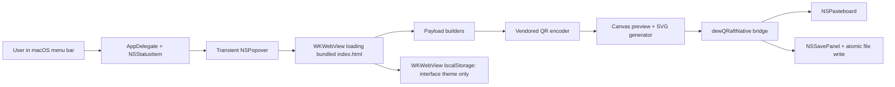
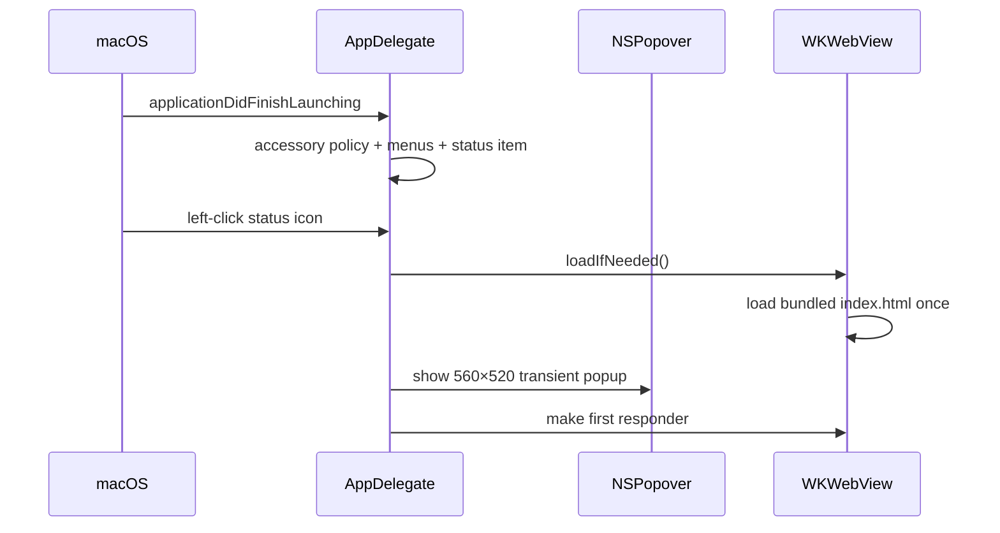

# DewQRaft Repository Learning Report

Assessment date: 20 July 2026
Repository state examined: `main` at `f4a7a5d` (`release: polish app and normalize repository`)

## How to read this report

This report explains the current repository as implemented. It does not treat historical plans as current code.

Evidence labels are used throughout:

- **Implemented** — directly supported by current source, tests, scripts, or artifacts.
- **Partial** — present, but incomplete or not validated through the whole user flow.
- **Planned** — described in a plan but absent from current source.
- **Inferred** — a reasonable conclusion from the implementation, not directly measured.
- **Unknown** — the repository does not provide enough evidence.

Primary evidence came from `AGENTS.md`, `README.md`, current Swift and web source, `Tests/SmokeTest.swift`, the build and packaging scripts, Git history, `BLOCKERS.md`, and `RELEASE-QA.md`. Historical `PLAN-*.md` files were read as records only, in accordance with `AGENTS.md`.

## 1. Executive overview

**Implemented.** DewQRaft is a small offline macOS menu-bar application for turning text or structured payloads into QR codes. Its native shell is written in Swift/AppKit. Most product UI and QR logic live in a single bundled `index.html`, rendered inside `WKWebView`. Copy and save actions cross a deliberately small JavaScript-to-Swift bridge.

The shortest accurate architectural description is:

> A native AppKit menu-bar host around a self-contained local web interface, with native clipboard and save-panel adapters.

There is no backend, account system, database, analytics SDK, package manager, Tailwind installation, JavaScript framework, or external web API. The only non-platform code is a vendored, MIT-licensed QR encoder by Kazuhiko Arase in `DewQRaft/Resources/vendor/`.

The codebase is compact enough to learn quickly:

- One Swift production file: `DewQRaft/DewQRaftApp.swift`.
- One HTML/CSS/JavaScript production file: `DewQRaft/Resources/index.html`.
- Two unchanged vendor scripts.
- One offscreen WebKit smoke-test program.
- Five small shell scripts plus one Swift icon-rendering script.

The central engineering strength is containment: QR creation is local, the native bridge has only three message types, and builds use temporary DerivedData and module caches. The central risk is not algorithmic complexity; it is end-to-end release confidence. `RELEASE-QA.md` still says **DO-NOT-SHIP**, every applicable manual row is `NOT RUN`, and the known transient-popover/save-panel behavior remains unresolved in current Swift source.

### Current evidence snapshot

| Area | Status | Evidence |
|---|---|---|
| Source tree | **Implemented** | Required source, tests, scripts, project file, and release artifacts are present. |
| Git worktree | **Implemented** | Git reported `main...origin/main` with no tracked changes before these reports were created. |
| Current `make verify` | **Partial / failing** | On 20 July 2026 it stopped at repository hygiene because ignored `.DS_Store` files exist at the root, under `DewQRaft/`, and under `build/`. |
| Visible local app | **Missing** | `build/` contains no `DewQRaft.app` at assessment time. |
| ZIP artifact | **Implemented / structurally valid** | `unzip -t` passed; extracted app is version 1.1, build 2, universal `arm64` + `x86_64`, and passes strict code-signature verification. |
| DMG artifact | **Implemented / structurally valid** | `hdiutil verify release/DewQRaft-1.1.dmg` reported a valid checksum. |
| Signature | **Implemented, distribution-limited** | Release app is ad-hoc signed, with no TeamIdentifier—not Developer ID signed or notarized. |
| App icon | **Implemented** | The ICNS in the ZIP matches `DewQRaft/Assets/DewQRaft.icns` byte-for-byte. The build also regenerates and compares the icon before compiling. |
| Automated web behavior | **Implemented, currently blocked by hygiene gate** | The smoke harness covers empty state, payloads, rendering, themes, layouts, export messages, and the completion callback. |
| Native/manual behavior | **Unknown / unverified** | Installed launch, physical scans, real clipboard use, save/cancel, menu behavior, theme persistence across relaunch, and full offline use remain manually unverified in `RELEASE-QA.md`. |

## 2. Repository map

```text
dewQRaft/
├── DewQRaft/
│   ├── DewQRaftApp.swift          AppKit lifecycle, popover, bridge, clipboard, save
│   ├── Info.plist                 identity, version, minimum macOS, agent-app flag
│   ├── Assets/
│   │   ├── AppIconSource.png      source artwork
│   │   └── DewQRaft.icns          generated app icon
│   └── Resources/
│       ├── index.html             all first-party UI, styling, state, QR/export logic
│       └── vendor/                vendored QR encoder; do not edit
├── DewQRaft.xcodeproj/
│   └── project.pbxproj            single application target definition
├── Tests/
│   └── SmokeTest.swift            offscreen WKWebView integration smoke test
├── Scripts/
│   ├── build.sh                   universal Release build and ad-hoc signing
│   ├── verify.sh                  hygiene, plist, project, scripts, build, smoke gates
│   ├── clean.sh                   local build/workspace cleanup
│   ├── package-release.sh         ZIP/DMG construction and validation
│   ├── update-icon.sh             committed ICNS regeneration
│   └── render-app-icon.swift      deterministic iconset renderer
├── build/                         intended to contain only DewQRaft.app
├── release/                       DewQRaft-1.1.dmg and DewQRaft-1.1.zip
├── Makefile                       stable command aliases
├── README.md                      user/developer overview
├── AGENTS.md                      current repository rules
├── RELEASE-QA.md                  manual release checklist and current verdict
├── BLOCKERS.md                    historical blocked-work record
└── PLAN-*.md                      historical implementation records
```

### Ownership boundaries

- **First-party native code:** `DewQRaft/DewQRaftApp.swift`.
- **First-party product UI:** all markup, CSS, and JavaScript in `DewQRaft/Resources/index.html`.
- **Third-party code:** only `DewQRaft/Resources/vendor/qrcode.js` and `qrcode_UTF8.js`. Their headers identify Kazuhiko Arase and the MIT license. `AGENTS.md` explicitly forbids editing them.
- **Generated but required asset:** `DewQRaft/Assets/DewQRaft.icns`.
- **Generated deliverables:** the app bundle in `build/` and the two release archives in `release/`.

## 3. Architecture

### Component diagram



### Native host

`AppDelegate` owns the three long-lived native objects: `NSStatusItem`, `NSPopover`, and `WebViewController` (`DewQRaft/DewQRaftApp.swift:10-13`). At launch it:

1. Sets `.accessory` activation policy so the app behaves as a menu-bar utility rather than a normal Dock app (`DewQRaftApp.swift:15-20`).
2. Creates a minimal app/edit menu so standard cut, copy, paste, select-all, and quit commands exist (`DewQRaftApp.swift:22-39`).
3. Creates a template status-bar icon and handles left and right mouse-up events (`DewQRaftApp.swift:41-50`).
4. Configures a 560×520 transient popover (`DewQRaftApp.swift:52-56`).

Left-click toggles the popover, activates the app, lazily loads the UI, and focuses the web view (`DewQRaftApp.swift:58-72`). Right-click temporarily attaches an `NSMenu` containing only Quit (`DewQRaftApp.swift:74-85`).

The program uses an explicit `@main` enum rather than a SwiftUI `App` scene. It creates `NSApplication.shared`, assigns a retained delegate, and enters `app.run()` (`DewQRaftApp.swift:239-248`).

### Web application

`WebViewController` uses `WKWebsiteDataStore.default()` so WebKit local storage survives process restarts (`DewQRaftApp.swift:88-98`). It loads only the bundled `index.html` and grants read access to its containing Resources directory, which is required for the two relative vendor scripts (`DewQRaftApp.swift:105-115`).

The web layer owns:

- All form fields and mode selection.
- Structured payload serialization.
- QR matrix creation through the vendor library.
- Canvas and SVG rendering.
- UI themes and the four CSS layout variants.
- Empty, ready, and overflow states.
- Native-message creation.

This is not a Tailwind project. Styling is handwritten CSS beginning at `index.html:7`; there is no build step, CSS compiler, `package.json`, or node dependency tree.

### Native bridge

The shared bridge name is `dewQRaftNative` (`DewQRaftApp.swift:93`; `index.html:1166-1170`). Its contract is intentionally narrow:

| Message type | JavaScript producer | Swift consumer | Effect |
|---|---|---|---|
| `copyPng` | `copyPng()` at `index.html:1173-1182` | `DewQRaftApp.swift:132-135` | Decode base64 PNG and write it to `NSPasteboard`. |
| `copyText` | `copySvg()` at `index.html:1192-1197` | `DewQRaftApp.swift:136-139` | Copy SVG source as plain text. |
| `save` | `savePng()` / `saveSvg()` at `index.html:1184-1205` | `DewQRaftApp.swift:140-141,157-195` | Present `NSSavePanel`, select an allowed type, and atomically write bytes. |

Swift sends completion text back through `window.dewQRaftNativeDone(...)` (`DewQRaftApp.swift:197-202`; `index.html:1359`). The web callback displays a temporary toast.

**Important limitation:** the protocol is command-oriented, not request/response-oriented. There are no operation IDs, structured errors, or cancellation callbacks. That is acceptable at this scale, but it becomes fragile if more native commands are added.

## 4. Runtime flows

### 4.1 Startup and popup



The web page is lazy-loaded on first popup open, not at process launch. Subsequent opens reuse the same controller and in-memory form state because `didLoad` prevents reloading. Closing the transient popup therefore does not itself clear content.

### 4.2 Payload creation

`activeMode` starts as `text` and `latest` starts as `null` (`index.html:1002-1004`). Every input, textarea, and select receives both `input` and `change` listeners that call `render()` (`index.html:1322-1324`). Mode buttons update `activeMode` and call `renderMode()` (`index.html:1326-1329`).

`qrPayload()` dispatches by mode (`index.html:1017-1034`):

- **Text/link:** trimmed input, with no initial DewFlash URL or any other default payload.
- **Wi-Fi:** `WIFI:T:...;S:...;P:...;H:...;;`, with QR-special characters escaped (`index.html:1036-1047`).
- **Contact:** vCard 3.0 with CRLF separators and escaped slashes, newlines, commas, and semicolons (`index.html:1049-1071`).
- **Email:** `mailto:` with `encodeURIComponent` query values (`index.html:1073-1080`).
- **Phone:** `tel:` with all whitespace removed (`index.html:1025-1028`).
- **SMS:** `sms:` with whitespace removed from the number and an encoded body query (`index.html:1082-1087`).

An empty required field produces an empty payload rather than a malformed QR. Oversized data is converted from the encoder's implementation error to the user-facing text “Too long for one QR code” (`index.html:1089-1092`).

### 4.3 QR generation and preview

`makeQr()` passes the payload and selected error-correction level into the vendored generator, calls `make()`, then converts its module accessors into a plain two-dimensional Boolean array (`index.html:1007-1015`). This isolates later drawing logic from the vendor object's API.

`render()` then:

1. Applies the selected QR background to the entire preview frame.
2. Computes and displays the payload.
3. Disables export actions for empty input.
4. Creates a QR matrix and redraws the canvas.
5. Shows Ready, Empty, or a friendly error state (`index.html:1094-1122`).

Canvas output uses a four-module quiet zone, a solid full-size background, integer module scaling, and a centering offset (`index.html:1124-1142`). SVG output uses the same quiet-zone concept, includes a full-size background rectangle, and requests crisp edges (`index.html:1144-1158`).

One subtle implementation difference is worth knowing:

- Canvas uses an integer `scale = floor(size / count)` and computes a centering offset.
- SVG uses a fractional `scale = size / count` and locates modules at `(x + quiet) * scale`.

Both are valid approaches, but physical scanning at all sizes and color combinations must be judged by real devices, not only by pixel-level tests.

### 4.4 Copy and save

For PNG, the current canvas is converted to a data URL and its base64 body is posted to Swift. For SVG, the XML string is posted directly. Browser fallbacks exist for both copy and download, but the packaged macOS app takes the native branch because the bridge is registered (`index.html:1166-1209`).

Swift clipboard operations are synchronous and small (`DewQRaftApp.swift:147-155`). Save is asynchronous:

1. Decode base64 or UTF-8 text.
2. Configure an `NSSavePanel` with the proposed filename and content type.
3. Call `panel.begin`.
4. On OK, atomically write to the chosen URL.
5. Report Saved or Save failed to JavaScript (`DewQRaftApp.swift:157-195`).

**Partial / known risk.** The host popover is `.transient`, and current save code does not coordinate closing or reopening it around `NSSavePanel`. `BLOCKERS.md` records that a proposed fix was implemented, automatically verified, then reverted because the native flow could not be manually accepted in that environment. Current source confirms the fix did not land. The actual installed behavior remains a release blocker until manually exercised.

### 4.5 Settings and persistence

The appearance button toggles a `settings-active` class on both panes (`index.html:1330-1335`). CSS then hides payload tabs, editors, reset, payload preview, and export actions while keeping only Look, Interface, QR Code controls, and the QR preview (`index.html:333-353`). A separate CSS block fixes the settings geometry across all four looks (`index.html:666-715`).

The persisted value is a single JSON object under `dewqraft.popupTheme.v2`:

```json
{
  "accent": "#0a84ff",
  "paper": "#f2f4f7",
  "look": "focused"
}
```

The code validates hex colors and allows only `focused`, `native`, `command`, or `original` (`index.html:1225-1266`). Interface accent, window color, and look persist. QR foreground and background do not persist; they reset on app reload and are also restored by Reset/Reset Colours (`index.html:1289-1314`). Payload fields are not written to persistent storage.

## 5. File-by-file guide

### `DewQRaft/DewQRaftApp.swift`

The entire native application. Its responsibilities are well separated by type and private methods despite being in one file:

- `AppConfig`: shared name and popup geometry.
- `AppDelegate`: lifecycle, native menus, menu-bar item, popup behavior.
- `WebViewController`: bundled page loading, native bridge, clipboard, save panel.
- `StatusIcon`: programmatically drawn template menu-bar glyph.
- `DewQRaftApplication`: entry point.

Because the file is only 248 lines and contains a single cohesive host, splitting it now would be optional. A split becomes valuable if preferences, launch-at-login, richer native error reporting, or UI automation support are added.

### `DewQRaft/Resources/index.html`

At 1,365 lines, this is the product's largest concentration of responsibility:

- Lines 1-743: document metadata and all CSS.
- Lines 744-952: the complete DOM.
- Lines 953-1365: application state, payload builders, QR drawing, bridge actions, theme persistence, and event wiring.

The single-file choice eliminates a frontend toolchain and makes offline bundling obvious. The tradeoff is cognitive coupling: layout, state, serialization, rendering, persistence, and native messages all change in the same file. The next maintainability boundary should be conceptual modules—not a framework migration for its own sake.

### `DewQRaft/Resources/vendor/`

Third-party QR implementation. Both source headers name Kazuhiko Arase and the MIT license. It is copied as a folder resource by Xcode. Per repository rules, do not modify it. Changes should be performed as an explicit vendor upgrade with license and compatibility review.

### `DewQRaft/Info.plist`

Defines version 1.1, build 2, bundle ID `com.dewflash.dewqraft`, macOS 13.0 minimum, the ICNS filename, and `LSUIElement=true` (`Info.plist:5-28`). `LSUIElement` supports the agent-style menu-bar behavior with no normal Dock presence.

### `DewQRaft.xcodeproj/project.pbxproj`

A deliberately minimal Xcode project:

- One macOS application target.
- One Swift source file.
- Bundled HTML, vendor folder, and ICNS resources.
- AppKit, WebKit, and UniformTypeIdentifiers frameworks.
- Swift 5 language mode and macOS 13 deployment target.
- Whole-module optimized Release compilation.

There is no Xcode test target; tests are invoked as a standalone Swift script.

### `Tests/SmokeTest.swift`

An integration-style harness rather than XCTest. It creates a nonpersistent, offscreen 560×520 `WKWebView`, loads the real HTML, evaluates JavaScript, and captures bridge messages through the same handler name as the app (`SmokeTest.swift:23-60`).

Its checks cover:

- Empty launch state and disabled actions.
- QR production, size, dark modules, opaque full-frame background.
- All six payload types and escaping.
- UTF-8 and overflow behavior.
- Reset behavior.
- Command-layout QR centering.
- Appearance-only settings mode.
- Stable settings geometry across all four looks.
- Theme application and color reset.
- The exact PNG/SVG copy/save bridge message shapes.
- Presence of the native completion callback.

This is unusually useful for a small hybrid app because it tests the real DOM and vendor encoder, not a duplicate model.

### `Scripts/`

- `build.sh`: renders the icon into a temporary directory, rejects a stale committed ICNS, invokes `xcodebuild` with temporary DerivedData and module caches, copies the Release app to `build/`, ad-hoc signs it, and verifies the signature (`build.sh:6-47`).
- `verify.sh`: checks repository hygiene, lints the plist, opens the Xcode project, syntax-checks scripts, performs a Release build, checks the app/version/icon/signature, and runs the smoke harness (`verify.sh:14-50`).
- `package-release.sh`: insists that the requested version matches Info.plist, rebuilds, creates ZIP and compressed DMG in a temporary staging area, validates both, then replaces `release/` with exactly the current pair (`package-release.sh:26-59`).
- `clean.sh`: removes visible build output and local Xcode workspace/user state.
- `render-app-icon.swift` and `update-icon.sh`: crop the source image, render all standard icon sizes, and produce the committed ICNS.

## 6. Language and framework education

### AppKit rather than SwiftUI

This app uses AppKit directly because its core surface is an `NSStatusItem` and `NSPopover`. AppKit gives explicit control over menu-bar event routing, transient popup behavior, `NSPasteboard`, and `NSSavePanel`. There is no SwiftUI view tree.

Important AppKit concepts in this repository:

- **Activation policy:** `.accessory` makes a background-style UI app (`DewQRaftApp.swift:16`).
- **Target/action:** status-button clicks and menu items call `@objc` methods (`DewQRaftApp.swift:47-49,58`).
- **Template image:** the status icon adapts to menu-bar appearance (`DewQRaftApp.swift:43-45,233-235`).
- **Transient popover:** clicking elsewhere can dismiss it (`DewQRaftApp.swift:53`). This convenience is also central to the save-flow risk.
- **Pasteboard:** native system clipboard interoperability (`DewQRaftApp.swift:147-155`).
- **Uniform Type Identifiers:** constrains the save panel to PNG or SVG (`DewQRaftApp.swift:186-195`).

### WebKit as the UI host

`WKWebView` allows a fully local web interface to behave as the app's content view. `WKUserContentController` supplies a controlled JavaScript-to-native channel. The app does not expose arbitrary native objects to JavaScript; it handles only dictionary messages with explicit `type` values.

The distinction between `WKWebsiteDataStore.default()` in production and `.nonPersistent()` in tests is intentional: the app persists its theme, while every smoke run starts isolated (`DewQRaftApp.swift:92`; `SmokeTest.swift:31`).

### Plain JavaScript state model

There is no framework lifecycle. State is three variables plus DOM values:

- `activeMode`: which payload serializer is active.
- `latest`: the last valid payload and Boolean QR matrix.
- `popupTheme`: persisted interface customization.

This works because the application is small and single-screen. The DOM itself holds form values. `render()` is the central reconciliation function. The cost is broad redraw triggering: every form control receives generic input/change listeners, even controls whose change could be handled more narrowly.

### CSS layout variants

The four looks are not four separate pages. They are CSS variants selected through `data-look`:

- `focused`: QR-first grid.
- `native`: the base two-pane layout.
- `command`: vertical mode rail and keyboard-oriented composition.
- `original`: warmer, larger classic two-pane styling.

This shared-DOM approach avoids behavior drift between designs. Settings overrides deliberately normalize geometry across every look. Dark-mode variables exist at `index.html:720-736`, and reduced-motion handling at `index.html:738-742`.

## 7. Data architecture and privacy

There is no domain database and no model layer beyond form fields and the current QR matrix.

| Data | Lifetime | Location | Notes |
|---|---|---|---|
| Typed payload fields | Process/web-view lifetime | DOM elements | Not written to localStorage. Reused while the loaded web view remains alive. |
| Active mode | Process/web-view lifetime | JavaScript variable | Starts as Text. |
| Latest QR matrix | Until next invalid/empty render | JavaScript memory | Used for canvas/SVG export. |
| Accent, window color, look | Across relaunches | WKWebView localStorage | Stored under `dewqraft.popupTheme.v2`. |
| QR code/background colors | Current web-view lifetime | DOM color controls | Not persisted. |
| Copied PNG/SVG | System clipboard lifetime | `NSPasteboard.general` | Leaves app memory only when the user invokes copy. |
| Saved export | User-selected filesystem location | Local disk | Written atomically after user confirmation. |

**Implemented by architecture.** All app resources and QR processing are local. No source code performs an external HTTP request; the only `fetch()` is a browser fallback against an already-generated `data:` URL. There are no accounts, analytics, network entitlements, remote fonts, or remote scripts.

**Not manually verified.** `RELEASE-QA.md` still marks its Wi-Fi-off test as `NOT RUN`, so “works identically offline in the installed build” remains an unperformed acceptance check even though the source architecture strongly supports it.

## 8. UI and accessibility

The DOM uses real `button`, `input`, `textarea`, `select`, `label`, and `nav` elements. The appearance button has a title, accessible label, and pressed state. Toasts use an `aria-live="polite"` container (`index.html:761,948`). Keyboard focus has an explicit visible ring (`index.html:520-523`), and reduced motion is respected.

The interface is fixed to 560×520 and intentionally clips body overflow (`index.html:28-38`), while the editor panel itself scrolls. This matches a menu-bar popup but makes layout regressions consequential: a few pixels can hide controls or cause overlap. The smoke test's geometry assertions are therefore valuable.

**Inferred concerns requiring human review:**

- Labels are often 10–11.5 px, which may be small for some users.
- Color is used strongly for selection and status; contrast under arbitrary user-selected accent/window colors is not constrained.
- Native VoiceOver order, keyboard traversal, color-well behavior, and focus restoration after closing settings are not tested.
- The four looks expand visual choice but also expand the manual screenshot and accessibility matrix.

## 9. Test strategy and gaps

### What is strong

The smoke harness crosses meaningful boundaries: real HTML, real vendor QR code, real canvas pixels, real CSS geometry, and real WebKit message dispatch. It checks outputs, not only function existence. It also keeps the native bridge contract synchronized with JavaScript.

### What it does not test

The harness captures bridge dictionaries but does not execute the real Swift consumers. Therefore it does not establish that:

- `NSPasteboard` contains a usable PNG or SVG after a packaged-app click.
- `NSSavePanel` appears correctly from a transient popover.
- Cancel writes no file.
- Save confirmation remains visible after popup dismissal.
- The menu-bar icon, left/right click behavior, and Quit work in an installed app.
- A phone scans exported QR codes correctly across payload types, sizes, colors, and correction levels.
- Appearance survives a real app relaunch.
- The DMG install path passes Gatekeeper on supported macOS versions.

Those are exactly the areas represented in the 24-row manual checklist. At assessment time, 23 applicable rows are `NOT RUN` and Launch at Login is explicitly skipped because it is not implemented.

### Recommended test layers

1. **Keep the current smoke test.** It is fast and high-value.
2. **Add focused pure payload fixtures.** Extract or expose serialization functions so a broad standards matrix can be tested without WebKit timing.
3. **Add native integration coverage.** Exercise Swift pasteboard and file-writing adapters with temporary pasteboard/file destinations where possible.
4. **Add a small installed-app UI smoke.** Validate status icon, popup, settings, save/cancel, and quit in a logged-in macOS session.
5. **Retain physical-device QR acceptance.** Cameras and receiving apps are the real interoperability contract.

## 10. Build, packaging, and release engineering

### Build path

`make build` delegates to `Scripts/build.sh`. The script creates a unique temporary workspace, renders and checks the icon, runs a generic macOS Release build with `ONLY_ACTIVE_ARCH=NO`, deletes any generated Xcode workspace/user state, copies exactly one app into `build/`, and ad-hoc signs it.

This is a good answer to hidden DerivedData accumulation. Both Clang and Swift module caches are redirected into the temporary directory and removed by an EXIT trap.

### Verification path

`make verify` is the intended hard gate and should finish with `VERIFY OK`. It validates repository hygiene before doing expensive work. That design is correct, but the current workspace fails this first check because ignored `.DS_Store` files are present. A clean Git status is therefore necessary but not sufficient evidence of repository hygiene.

### Packaging path

`make package` rebuilds rather than trusting an old app, checks the signature, stages a ZIP and DMG in a temporary directory, adds an Applications symlink to the DMG, validates both containers, and replaces the entire release directory. That keeps release naming predictable and prevents stale versions from accumulating.

### Current release artifact evidence

The checked-in 1.1 artifacts were independently inspected during this assessment:

- ZIP integrity: passed.
- DMG checksum: passed.
- Embedded version: 1.1, build 2.
- Deployment target: macOS 13.0.
- App mode: `LSUIElement=true`.
- Binary: universal `x86_64` and `arm64`.
- Signature verification: passed, ad-hoc.
- Embedded ICNS SHA-256: matches the current repository ICNS.

This proves container and bundle consistency, not user-flow correctness.

## 11. Engineering critique

### Strengths

1. **Small, legible architecture.** The boundary between web product logic and native system adapters is easy to trace.
2. **Offline by construction.** Bundled resources and no backend reduce privacy, latency, outage, and operating-cost concerns.
3. **Narrow bridge surface.** Three message types are easier to reason about and test than a broad native API.
4. **Good generated-output discipline in scripts.** Temporary caches, deterministic icon checks, one visible app, and one release pair are explicit.
5. **Useful real-UI smoke testing.** It catches payload, rendering, layout, and contract regressions without duplicating the product implementation.
6. **Honest historical records.** Reverted work and failed acceptance are documented rather than misrepresented as complete.

### Risks and debt

1. **Release confidence is below feature confidence.** The source contains many implemented features, but the installed native workflow and physical scan matrix have no recorded passes.
2. **Known save-flow gap.** The transient-popover/native-panel interaction is not resolved or manually accepted.
3. **Workspace hygiene currently breaks the primary gate.** Ignored `.DS_Store` files make `make verify` fail immediately, and `build/DewQRaft.app` is absent.
4. **Monolithic web file.** `index.html` is convenient but now combines enough concerns that changes can cause accidental coupling.
5. **No native automated tests.** Bridge consumers, pasteboard behavior, save writing, menu events, and app lifecycle are outside the automated suite.
6. **Ad-hoc distribution.** It is technically signed but lacks Developer ID signing and notarization, creating first-launch friction and limiting mainstream distribution readiness.
7. **Theme freedom can undermine accessibility.** Arbitrary accent and paper choices have no contrast validation.
8. **Third-party notice could be more explicit.** Vendor headers carry the MIT notice, but a root `THIRD-PARTY-NOTICES.md` would make redistribution provenance easier to audit.

### Maintainability recommendations

The next refactor should be small and boundary-driven:

- Move payload serialization into a dedicated local script with pure functions.
- Move theme/storage behavior into a second local script.
- Keep DOM wiring/rendering in the page or a UI script.
- Preserve zero-build-step operation unless a concrete complexity problem justifies tooling.
- Introduce a typed Swift representation for bridge messages before adding more native operations.
- Treat UI looks as CSS tokens/layouts over one semantic DOM, as the current code already does.

A migration to SwiftUI, Tailwind, React, or another framework is not inherently necessary. It would increase build and dependency surface without solving the current top risks: save-panel behavior, manual interoperability, accessibility, signing, and release hygiene.

## 12. Suggested learning path for a new developer

1. Read `README.md` and `AGENTS.md` to understand product intent and repository constraints.
2. Read `DewQRaft/DewQRaftApp.swift` from top to bottom; it is the entire native lifecycle.
3. In `index.html`, read the DOM at lines 744-952 before the CSS. This reveals the semantic product structure.
4. Read JavaScript from `qrPayload()` through `saveSvg()` to understand the core value path.
5. Read theme persistence and event wiring at lines 1225-1361.
6. Read `Tests/SmokeTest.swift` beside the web code to see which behaviors are protected.
7. Read `Scripts/verify.sh`, then `build.sh` and `package-release.sh`, to understand the delivery gates.
8. Read `RELEASE-QA.md` and `BLOCKERS.md` last to understand what source inspection and automated checks still cannot prove.

## 13. Learning summary

DewQRaft is not a complex application hidden behind a large framework. It is a deliberately compact hybrid utility:

- AppKit supplies the macOS-native lifecycle and system integrations.
- WebKit hosts a bundled, dependency-free user interface.
- Plain JavaScript serializes payloads and orchestrates QR rendering.
- A vendored encoder supplies the QR matrix.
- Canvas and SVG code produce the export forms.
- A three-command bridge hands clipboard/save work back to macOS.
- Shell scripts make builds and release artifacts predictable.

The repository is easiest to improve by preserving that simplicity and raising confidence around its native edges. The highest-value engineering work is not adding more QR features. It is making `make verify` green from a genuinely clean tree, resolving and validating save-panel behavior, exercising the installed app and real scanners, and establishing a trusted signing/distribution path.
